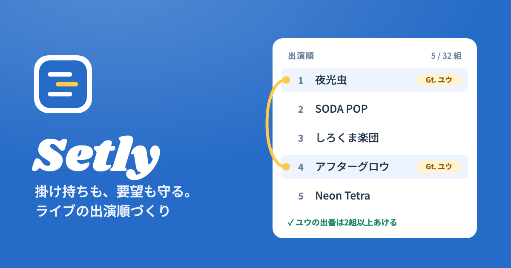
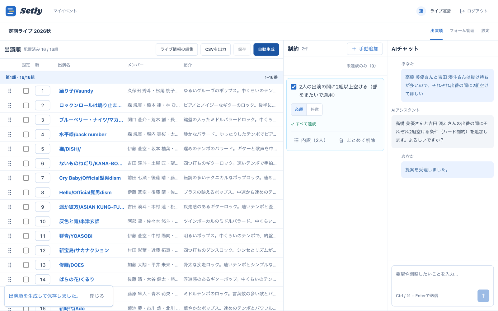
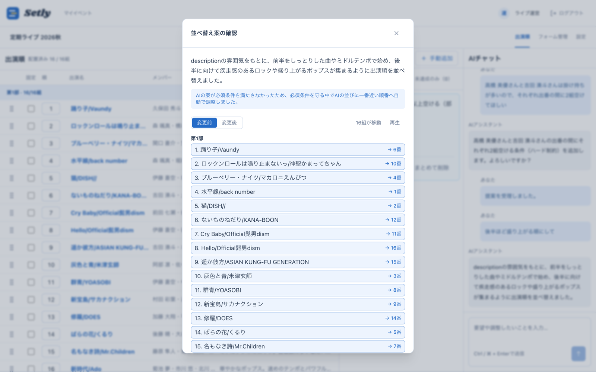
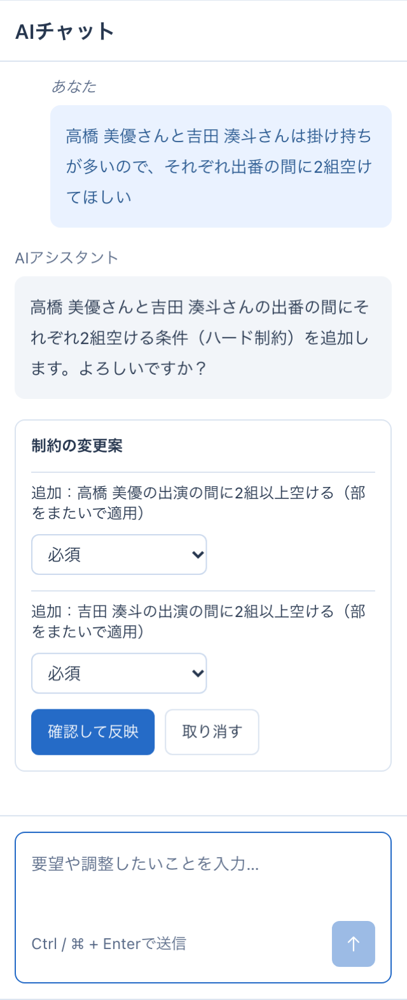
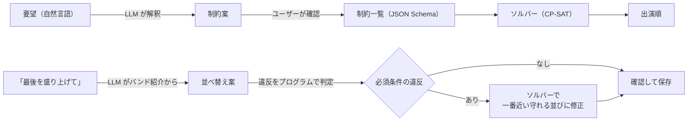

# [Setly](https://setly.jphack-2026.workers.dev)

**掛け持ちも、要望も守る。ライブの出演順づくり。**

Setly は、ライブの「出演順」をつくるためのアプリです。
「同じ人の出番を空けたい」のような**絶対に守るべき条件**（画面では「制約」）はソルバーが計算で守り、「最後に向けて盛り上げたい」のような**感覚的な要望**は AI がくみ取ります。

## 各種リンク

- **アプリ**：https://setly.jphack-2026.workers.dev
- デモ動画：<!-- TODO: URL -->

> [!TIP]
> 「イベントを作成」→「サンプルから選ぶ」で、名簿の登録まで済んだ状態からすぐに試せます（下の[試してみる](#試してみる)を参照）。PCでの利用がおすすめです。

## 製品概要

### 背景（製品開発のきっかけ、課題等）

#### こんな人のためにつくりました

> **軽音サークルのライブ担当・Aさん（大学3年）**
>
> - 定期ライブのたびに、30組前後の出演順を1人で決めている
> - 部員の多くが2〜5バンドを掛け持ち。多い人は7バンド
> - 「3部からしか来られない」「トリをやりたい」「このバンドとは離して」といった要望が LINE でばらばらに届く
> - 最後は「後半に向けて盛り上がる流れにしたい」という、数字にできない気持ちもある

Aさんは今、これをスプレッドシートと頭の中で解いています。

- 同じ人が連続で出ると、楽器の持ち替えや着替えが間に合わない
- 1か所動かすと別の誰かの条件が崩れ、全部守れているかの確認だけで何時間もかかる
- 要望を覚えておくのも、全員に「守れているよ」と説明するのも大変

**条件が多すぎて、人の手では「全部守れているか」が分からない…** これが Setly で解きたい課題です。

### 製品説明（具体的な製品の説明）

Setly は、**絶対に守りたいこと**と**なんとなくこうしたいこと**を分けて扱います。

1. **集める**：出演者フォームで、バンドとメンバー（掛け持ちも含めて）を登録してもらう
2. **伝える**：「田中さんの出番は2組以上空けて」と AI チャットに話すか、画面から選んで条件を追加する
3. **つくる**：「自動生成」を押すと、ソルバーが必須の条件をすべて守った出演順をつくる
4. **仕上げる**：「最後が盛り上がるようにして」と頼むと AI が並べ替え案を出す。あとはドラッグで微調整

どの段階でも、条件ごとの「達成／違反」がその場で見えます。

<!-- TODO: 出演順画面のGIF -->

### 特長

#### 1. 必須の条件は、ソルバーが絶対に守る

掛け持ちの間隔、出演位置の指定、前後関係などは数理最適化（OR-Tools CP-SAT）で解きます。両立しない条件があるときは、勝手にゆるめずに「解なし」と伝えます。掛け持ちの多いライブなら、掛け持ちしている全員に間隔の条件をまとめてかけることもできます。

#### 2. 「盛り上がる順に」は、AI が気持ちをくみ取る

数字にできない希望は、AI（Gemini）がバンド紹介を読んで並べ替え案をつくります。AI の案が必須の条件を破っていても、ソルバーが**条件を守ったまま AI の案に一番近い並び**に直します。

#### 3. 話しかけるだけで条件になる。でも勝手には変えない

チャットで話した要望は、AI が条件の追加・変更案にします。反映するのは、ユーザーが内容を確認してから。AI の並べ替え案も、変わる並びと条件の達成状況を見てから保存します。

#### 4. 並べ替えの「流れ」が見える

自動生成でも AI の提案でも、行がスルッと新しい位置にスライドします。AI の並べ替え案は「変更前／変更後」を切り替えたり再生したりでき、どのバンドがどこへ動いたのかを目で追ってから保存できます。

### 解決出来ること

- 掛け持ちの出番がかぶる・近すぎる、という事故をなくせる
- ばらばらに届く要望を、条件として一か所に残しておける
- 「本当に全部守れてる？」の確認作業がいらなくなる
- 「なんでうちがトップバッター？」と揉めがちな感覚的な決め方も、AI がバンド紹介をもとに案を出すので、担当者の好みではなく根拠のある順番として説明できる
- 何時間もかかっていた出演順のたたき台が、ボタン1つでできる

### 今後の展望

- 演奏動画や音源から雰囲気を読み取り、紹介文がなくても「盛り上がる順」をつくれるようにする
- AI チャットから、そのまま自動生成まで実行できるようにする
- ログインと、運営チームでの共同編集

### 注力したこと（こだわり等）

#### LLM とソルバーの役割分担

LLM は自然な言葉をよく理解しますが、「全部守れています」と自信満々に間違えることもあります。出演順は1つのミスで誰かが出られなくなるので、**LLM に任せる範囲をはっきり線引きしました。**

| 担当               | 任せること                                                               | 任せないこと                               |
| ------------------ | ------------------------------------------------------------------------ | ------------------------------------------ |
| LLM（Gemini）      | 要望を条件に置き換える、バンド紹介を読んで並べ替え案をつくる、意図の説明 | 条件を守れているかの判定、必須の条件の緩和 |
| ソルバー（CP-SAT） | 必須の条件をすべて守る並びの探索、AI の案を一番近い守れる並びへ直す      | 雰囲気の判断                               |
| プログラム         | 条件ごとの達成・違反の判定、AI の出力の形と対象の検証                    | —                                          |

- **AI の出力は決まった形にしか出させない。** 条件は6種類の共通スキーマに限り、存在しないバンドや人を指していないかをバックエンドで検証します。情報が足りないときは推測で埋めず、聞き返します。
- **雰囲気の要望も、消えない条件にする。** 「同じジャンルを隣にしない」のような要望は、LLM がバンド紹介から当てはまるバンドを選んで任意の条件にします。並べ替え案と違って、再生成しても残ります。
- **AI の判断を、実際の Gemini で回帰テスト。** 指示文を変えても、要望の振り分けや条件への置き換えが崩れていないかを評価するテストを用意しました。
- **最後は人が確認してから反映。** 条件も並べ替えも、変わる内容と達成状況の増減を見せてから保存します。

## 試してみる

[Setly](https://setly.jphack-2026.workers.dev) の「イベントを作成」で「サンプルから選ぶ」を選ぶと、名簿の登録と部のバンド数の設定まで済んだ状態で始められます。手元の CSV も同じ欄から取り込めます。

| サンプル名簿                                                                                   | バンド数 | 特徴                                         |
| ---------------------------------------------------------------------------------------------- | -------- | -------------------------------------------- |
| [定期ライブ（邦ロック）](https://setly.jphack-2026.workers.dev/samples/roster-regular-16.csv)  | 16       | 標準的な掛け持ち                             |
| [卒業ライブ](https://setly.jphack-2026.workers.dev/samples/roster-graduation-18.csv)           | 18       | 掛け持ちが多い（1人で最大7バンド）           |
| [アニソン・ボカロ](https://setly.jphack-2026.workers.dev/samples/roster-anime-vocaloid-14.csv) | 14       | 中心メンバー2人が5バンドずつ                 |
| [洋楽コピー](https://setly.jphack-2026.workers.dev/samples/roster-western-12.csv)              | 12       | 掛け持ちがほぼない                           |
| [学祭ステージ](https://setly.jphack-2026.workers.dev/samples/roster-festival-20.csv)           | 20       | ソロ・デュオ・ヒップホップなどジャンルが混在 |

曲は実在の曲、メンバー名はすべて架空です。

## 開発技術

### 活用した技術

#### フロントエンド

- **React + TypeScript + Vite + Tailwind CSS + dnd-kit**：画面の実装と、ドラッグ＆ドロップでの出演順の編集

#### バックエンド

- **Hono + TypeScript + Hono RPC + Zod**：API の実装、フロントエンドとの型共有、入力検証
- **Cloudflare D1 + Drizzle ORM**：イベント・出演者・制約・出演順・チャット履歴の保存
- **Gemini API（Google AI Studio）**：要望からの制約案の作成と、バンド紹介をもとにした並べ替え案の作成
- **JSON Schema**：制約の定義を1つにまとめ、TypeScript の型と Python のモデルを自動生成
- **OpenAPI + Swagger UI**：API 仕様の共有と動作確認

#### ソルバー

- **Python + FastAPI + Pydantic**：出演順を計算する API
- **Google OR-Tools CP-SAT**：制約を満たす出演順の探索と、AI の並べ替え案の修正

#### インフラ・開発

- **Cloudflare Workers / Vercel**：Web アプリ・API と、ソルバー API の実行環境
- **GitHub Actions**：push・PR ごとに静的解析・型・生成コードの整合性・ビルド・テスト（Vitest / Playwright / pytest）を自動実行
- **ESLint + Prettier + Husky + lint-staged**：コードスタイルの統一とコミット時のチェック

#### デバイス

- PC・スマートフォンの Web ブラウザ

### 独自技術

#### ハッカソンで開発した独自機能・技術

##### LLM とソルバーを組み合わせた出演順の生成

出演順づくりには、「同じメンバーの出番を2組以上空けたい」のような明確な条件と、「後半に向けて盛り上がる流れにしたい」のような感覚的な要望が混在しています。そこで、**LLM の自然言語を解釈する力**と、**ソルバーの条件を満たす組み合わせを探す力**を組み合わせました。

- **出演順のソルバー**：掛け持ちの間隔・位置・前後関係・出演できる範囲を CP-SAT の制約にして解きます。→ [solver_constraints.py](apps/solver/src/solver_constraints.py)
- **AI の並べ替え案 × ソルバーでの修正**：AI の案に必須条件の違反があれば、元の案に一番近い守れる並びに直します。→ [generate.ts](apps/backend/src/services/chat/generate.ts)、[reorder.ts](apps/backend/src/services/chat/reorder.ts)
- **制約の共通スキーマ**：画面・API・ソルバーで同じ制約の定義を使います。→ [apps/schema](apps/schema)

## 開発者向けリンク

- [develop 環境の API ドキュメント（Swagger UI）](https://dev.jphack-2026.workers.dev/api/docs)
- [API ドキュメントの更新・公開手順](apps/backend/docs/api/README.md)
- [環境構築](docs/setup.md)
