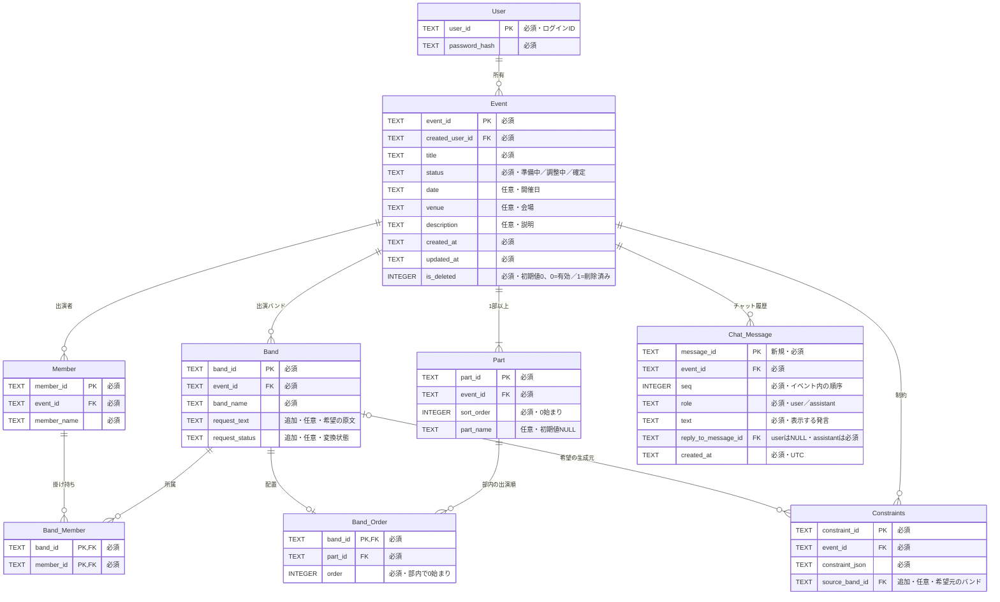

# AIチャット設計

フォームの希望を制約へ変換し、手動追加と同じ一覧・JSONで扱うための最小設計。**希望・由来・部名・チャット履歴のDB定義、migration、既存の保存処理への追従は#45で実装。LLM・フォーム・チャットの業務APIは後続Issueで接続する。**

#45の変更対象はbackendと関連資料のみ。部名の画面表示・frontendモデルへの反映は#32で扱い、この変更ではfrontendを編集しない。

## 1. やりたいことと役割

| やりたいこと                                     | 担当                                                           |
| ------------------------------------------------ | -------------------------------------------------------------- |
| フォームの自然文の希望を計算可能な制約へ変換する | LLM＋backendの検証                                             |
| 検証できた制約を一覧へ自動追加する               | backendで保存し、frontendが同じJSONを表示                      |
| 管理者が手動で制約を追加・編集する               | 構造化した入力をプログラムでJSONへ変換                         |
| 画面の全制約とJSONを一対一に保つ                 | 共通のConstraint配列とconstraint_idで管理                      |
| 出演順を計算する                                 | 実行ボタン、またはチャットで明確に依頼されたときにSolverを呼ぶ |

**LLMに一覧全体のJSONを毎回作り直させない。** 手動入力は既に項目が決まっているので、現在の実装と同じプログラムによる変換でよい。LLMが必要なのは自由文の解釈と、チャットでの要望・実行意図の判別。

2026-10-17の合意：フォームの希望から検証できた制約は、承認専用の別一覧を挟まず、**有効な制約として画面へ自動追加する**。制約が追加されたことだけではSolverを起動しない。

## 2. 画面・JSON・DBの対応

**制約カード1件＝Constraint JSON 1件＝Constraintsの1行。** 全て同じconstraint_idを使う。日本語の表示はJSONから生成する。

- 手動追加：入力欄 → 既存のbuildConstraint → Constraint JSON → 同じ一覧。
- フォーム：希望原文 → LLM → backendで検証 → Constraint JSON → 同じ一覧。
- チャット：自由文 → LLM → 対象ID・変更内容を検証し、必要な確認を行う → 同じ一覧への追加・更新・削除。曖昧なら質問する。
- 一覧の編集・無効化・削除は、そのIDのJSONを直接更新する。表示用の自由文とJSONを別々の正本にしない。
- 全件のJSONは共通配列をそのままシリアライズする。無効な制約も一覧・保存データには残し、計算時はenabledに従って除外する。
- 1つの希望から複数の制約が生まれることはある。一対一にする対象は「希望文とJSON」ではなく「制約カードとJSON」。

例：Aの希望が「必須で第2部にして、Bより前にして」なら、in_rangeとbeforeの2件を作り、カードも2枚表示する。元の希望はBandに1件、生成されたConstraintsは2行になる。

現在の実装でも、手動入力は `features/event/model/constraintDraft.ts` のbuildConstraintでJSONになり、`ConstraintsPanel.tsx` はそのJSONを表示している。この構造を維持してフォーム・実LLMを接続する。

## 3. フォームの希望を取り込む流れ

1. Band・Member・所属とともに、**希望の原文をBand.request_textへ保存**する。原文が空ならLLMは呼ばない。
2. 希望があるBandはrequest_status=pendingにする。登録は先に保存するので、LLM失敗で名簿・原文が消えない。
3. Lunaのlowへ、希望原文・回答元のband_id・同イベントのID付き名簿・部・現在の制約を渡す。
4. backendが6種類の共有スキーマ、対象IDの存在・イベント所属、hard/priority、位置・部・数値を検証する。
5. 全件が検証できたら、新しいconstraint_idを発行し、source_textに原文、enabled=trueを設定する。Constraintsへの追加、Bandのconverted化、Event.updatedAtの更新を同じD1 batchで保存する。
6. 保存されたJSONを管理画面で取得し、制約カードを自動表示する。開いたままの管理画面も更新する必要があるので、MVPは短い間隔の再取得で実現する案。WebSocket専用基盤は増やさない。

対象が同名で特定できない、数値・部・hard/soft・優先度の必要情報が欠ける、未対応の要望ならneeds_confirmationにする。未完成JSONをConstraintsに混ぜず、希望原文と要確認表示を残し、管理者の補足・入力で解決する。通信失敗はfailedとし、原文を残して再試行できる。

hard/soft・softの優先度が未指定の場合の既定値は未合意。LLMに任意の既定値を作らせない。変換できなかった希望を「反映済み」とは表示せず、計算前にも未反映件数が分かるようにする。

## 4. 計算を始めるタイミング

**実行ボタンと、チャットでの明確な生成依頼を、同じbackendの計算処理へ接続する。** 制約変更の確認と、計算実行の依頼は別に扱う。

| 操作・発言                               | 処理                                              |
| ---------------------------------------- | ------------------------------------------------- |
| フォームに希望を送る                     | 希望を保存・制約へ変換・自動追加。計算しない      |
| 手動で制約を追加・編集する               | 制約JSONと一覧を更新。計算しない                  |
| チャットで「Aを第2部にして」             | 制約を追加・更新。計算依頼とは扱わない            |
| 実行ボタン／「今の条件で出演順を作って」 | 最新条件を検証・必要な保存をして、Solverを1回呼ぶ |
| 「Aを第2部にして、生成し直して」         | 制約変更の検証・保存が成功してから、Solverを呼ぶ  |

LLMは決められた「制約変更／確認質問／計算依頼」等の種類を返し、backendが処理を組み立てる。フォームの希望や過去の会話に「実行」と書かれていても、それを新しい実行依頼として扱わない。意図が曖昧なら質問する。

計算前に最新の画面上の制約を使い、既存方針どおり保存してからSolverへ渡す。保存に失敗・競合した場合は計算しない。結果の扱いは既存のBE - Solver API設計へ合わせ、成功・部分配置・解なし・探索未完了・内部エラーを区別する。

## 5. DB定義（#45）

| 対象                                    | 変更するもの                             | 理由                                                           |
| --------------------------------------- | ---------------------------------------- | -------------------------------------------------------------- |
| Part                                    | commentをpart_nameへ変更                 | 補足ではなく部名を保存する（2026-10-17 合意）                  |
| Band                                    | request_text：TEXT・NULL可               | 元の希望を残し、変換に失敗しても再処理できる                   |
| Band                                    | request_status：TEXT・NULL可             | 未変換／要確認／変換済み／失敗を区別する                       |
| Constraints                             | source_band_id：TEXT・NULL可・BandへのFK | フォーム由来の制約を元の希望へ紐づける。対象バンドとは別の情報 |
| Chat_Message（物理名案：chat_messages） | イベント別の発言履歴                     | イベントを開き直して会話を続けるため                           |

**新規テーブルはチャット履歴の1つだけ。** 会話・送信処理・制約候補・要約用の独立テーブルは作らない。制約JSONの形式の正本は引き続きapps/schema。

### Bandの希望と変換状態

- request_textはバンド単位の「現在の希望」1件。フォームの既存モックのPerformanceDraft.requests／Submission.requestsに対応する原文の保存先。
- 希望なしはrequest_text=NULL・request_status=NULL。希望ありは `pending / needs_confirmation / converted / failed` のいずれか。
- convertedは「希望を制約へ変換した」を表し、「出演順を計算済み」「希望を満たす配置ができた」を意味しない。
- 希望の更新・再変換では、source_band_idで既存の由来制約を見つける。既存の制約を重複追加したり、管理者の修正を黙って上書きしたりしない。初回以外の変換結果は差分を確認して反映する案。一般的な変更履歴テーブルは作らない。
- フォームの複数回答履歴、連絡先、受付設定・公開範囲は別の未決定事項（#33）。今回、希望を保存するためだけにSubmissionテーブルを新設しない。

### Constraintsの由来

- 既存のconstraint_id・event_id・constraint_jsonはそのまま使い、source_band_idだけ追加する。
- source_band_idは「どのBandの希望から作ったか」。制約のtargetsが別のバンドやメンバーを指すこともあるので、targetsから生成元を推測しない。
- 1つのBandの希望から0〜複数のConstraintsが作られる。手動追加・チャット由来でフォームの希望に紐づかない場合はNULL。
- source_textは既存JSONの任意項目を使う。type・hardness等を別列へ重複定義せず、由来だけをDB側のメタデータとして持つ。
- FKの存在確認に加えて、元のBandとConstraintsが同じイベントであることを検証する。
- saveEventはConstraintsを一括削除・再挿入する際、同じIDのsource_band_idをbackendで引き継ぐ。Bandのrequest_text・request_statusも通常保存で保持し、クライアントの余分なフィールドで上書きしない。

### Chat_Messageの最小保存

- 1イベントの全発言をevent_idで取得する。会話そのもののテーブルは作らない。
- message_id（PK）、event_id（FK）、seq（イベント内の順序）、role（user/assistant）、text、reply_to_message_id（userはNULL、assistantは同イベントの先行userを必須とする）、created_atを保存する。
- `(event_id, seq)`を一意にし、並び順とページングに使う。seqはDB内で原子的に採番する。
- 送信時のmessage_idを再送でも維持し、同じID・同じ本文のユーザー発言を増やさない。AI回答のreply_to_message_idは一意にし、同じユーザー発言に回答を重複保存しない。参照先のイベント・roleも検証する。
- 失敗はAPI応答・画面の状態で表示し、ユーザー発言は残す。同じ発言に再試行でき、回答が既にあれば取得して返す。新しい発言・再試行ともfrontendの送信中操作を抑止する。
- 複数タブから同時再送された場合のLLM二重呼出しまで完全には止めない。回答の二重保存は防ぐが、分散ロック・永続ジョブはMVPに追加しない。
- チャットでの実行依頼も同じユーザー発言を再利用し、完了済み回答がある場合は再計算しない。タイムアウト等で結果不明の再試行は再計算されうる。古い結果で上書きしないことは既存イベントのupdatedAtによる競合確認で守る。
- 会話の保存と、業務データの更新日時は分ける。発言の追加だけではEvent.updatedAtを更新しない。

## 6. 既存DBに追加した全体ER図

既存8テーブルは維持し、追加列を「追加」、新テーブルを「新規」と示す。Partは旧commentをpart_nameへ変更して部名を保存する。PKは主キー、FKは外部キー。日時・JSON・IDは既存と同じTEXT。DB定義を示す図であり、業務APIの接続・リモートDBへの適用完了は意味しない。

既存のイベント所有者・論理削除、同イベント内の所属・配置、部・配置の一意性、制約JSONと列のID一致などの制約は維持する。イベントを削除したら、希望・制約・チャットも通常の取得・更新対象から外す。

Partの部名は`part_name`、並び順は`sort_order`で分ける。部名はNULL可・初期値NULL、空欄の表示は「第n部」。0002 migrationで旧commentの値とNULLを維持して列名を変更する。

## 7. 保存・画面同期で必要な最低限の処理

- 名簿・希望の登録と、LLM変換結果の保存は分ける。LLM失敗でも原文・登録データを保持する。
- 変換結果の保存は「Constraintsの全件追加＋request_status=converted＋Event.updatedAt更新」を同じD1 batchで行う。LLM通信中はDBのトランザクションを保持しない。
- 保存時にイベントの存在・削除状態、原文が生成時から変わっていないこと、request_status、Event.updatedAtを再確認する。重複送信・並列変換でも2組の同じ制約を追加しない。別の名簿変更等で競合したら最新状態で再検証・再試行する。
- 管理者の通常保存は既存のupdatedAtによる競合検出を使う。フォームから制約が追加された後に、古い管理画面の全件保存で消してしまうことを防ぐ。
- 未保存のローカル編集がある管理画面は再取得データで丸ごと上書きしない。更新を通知し、保存前に最新データとの確認を行う。未保存内容のリアルタイム共同編集は追加しない。
- JSONの形・参照ID・hard/soft等の検証と、制約同士が両立するかは別。構造が正しくても矛盾しうる。矛盾はSolverで扱い、hardを勝手に緩めない。

## 8. LLM・記憶・速度

- 合意済み：OpenAI APIの **GPT-6 Luna（gpt-6-luna）、reasoning.effort=low**。Responses APIで接続する案。
- フォーム変換にはチャット全履歴を付けない。希望・ID付き名簿・部・現在制約を渡す。
- チャットには最新の業務JSON＋直近の会話を入力予算内で渡す。過去の発言から現在制約を復元しない。
- 原文履歴はDBへ保存するが、全履歴は毎回送らない。範囲外の古い「さっきの条件」等が特定できない場合は、必要な発言を取得するか確認する。
- 要約・学習メモリ・Redis・汎用ツール実行基盤は、最初の必須にはしない。長い会話で必要性を確認して追加する。
- 接続後、同じ30〜40バンド・希望例で「LLM待ち／DB取得・保存／全体時間」、p50・p95、正しく制約化できた割合を測る。通常テストはLLMをモックし、実速度測定は別実行する。

## 9. 実装順とIssueの担当境界

1. #30：自然文→6種類の制約／要確認の例、hard/soft未指定時の扱い、チャットの計算意図を決める。Luna・low、自動追加・実行タイミングは今回の合意を反映する。
2. #33の範囲を確認し、フォームの実保存と希望変換の接続タスクを具体化する。既存Issueはフォーム方式の検討までで、実API実装は含まない。
3. #17・#31：共通の実行時検証とLLM変換。#31の変換Serviceは保存・計算を直接行わず、フォーム／チャット側のServiceが保存と実行を組み立てる。
4. #18・#19・#32：共通制約一覧、希望原文と由来の保存、更新競合、自動追加、最小のチャット履歴を接続する。
5. #28・#29・#32：ボタンとチャットの実行依頼を同じSolver呼出しへ接続し、制約だけの変更では呼ばないことを確認する。

従来の「候補テーブル・実行テーブル・要約テーブルを追加する」計画は、この最小案では採用しない。#30・#32・docs/product.mdの確認後適用という従来仕様と異なるため、実装時は今回合意した自動追加の範囲をリポジトリ仕様・Issue本文へ揃える。2026-10-17に下記のGitHub Issue計画へ反映済み。履歴取得の`GET /api/events/{eventId}/chat`は実装済み（[イベントAPI](api/events.md)）。LLM・フォーム・チャット送信の業務APIは未実装。

## GitHubの実装タスク（2026-10-17更新）

各Issueの担当境界を示す。#45のDB基盤を除く処理は後続実装。

| Issue                                                | 担当する処理                                                   |
| ---------------------------------------------------- | -------------------------------------------------------------- |
| [#30](https://github.com/jphacks/tka_2604/issues/30) | 構造化出力・制約保存・計算依頼の契約と具体例                   |
| [#31](https://github.com/jphacks/tka_2604/issues/31) | Luna low＋Structured Outputsから検証済みConstraintを返す       |
| [#32](https://github.com/jphacks/tka_2604/issues/32) | 共通制約一覧・自動表示・チャットの画面接続                     |
| [#45](https://github.com/jphacks/tka_2604/issues/45) | Drizzleスキーマ・追加migration・既存データ移行・取得保存の追従 |
| [#46](https://github.com/jphacks/tka_2604/issues/46) | 希望原文を残し、フォームから制約へ変換してDBへ自動保存         |
| [#47](https://github.com/jphacks/tka_2604/issues/47) | 最小の履歴APIとチャットの制約変更／計算依頼の組立              |

関連の#17・#18・#19・#28・#29・#33・#34にも検証・保存・実行タイミング・フォーム範囲・速度計測の担当境界を追記済み。

### 構造化出力からDB・Solverまで

`原文 → Structured Outputs用DTO → backendで管理項目を確定 → apps/schemaと業務検証 → 完成したConstraint → ConstraintsへJSON文字列として保存 → 再取得・パース・検証 → Solver入力のconstraints配列`

- Responses APIの`text.format`へJSON Schemaと`strict: true`を指定する。モデルは`gpt-6-luna`、`reasoning.effort: low`。
- 元のSchemaを正本に保ち、LLM API向けにはobjectで包み、参照・union・optional/null等の対応を調整する。6typeの意味を別定義に複製したり、モデルに合わせて元Schemaを緩めたりしない。
- Structured Outputsでも対象ID・意味・イベント所属が正しいとは限らない。拒否・未完了・出力切断も成功と扱わない。
- backendがevent_id、新規constraint_id、元のsource_text、自動追加時のenabledを確定し、全必須項目を持つConstraintを検証して保存する。
- DrizzleのDB行型と共有Constraint型は別。DBのTEXTは取得時にJSONとして復元する。source_band_id等のDBメタデータはSolver用のJSONへ混ぜない。
- #31は変換を担当し、実際の保存は#46・#47が#18を利用する。#28は保存済み最新JSONと名簿・部・所属・配置を同時点に揃えてSolverへ渡す。

DB変更は`apps/backend/src/db/schema.ts`更新 → `npm run db:generate` → SQL・meta・journal確認 → `npm run db:migrate:local` → 実D1で移行・結合テスト → `npm run check`。既存migrationは変更せず、remote DBへの適用は別依頼時だけ行う。

[公開の公式資料：Structured Outputs](https://developers.openai.com/api/docs/guides/structured-outputs)

## 10. 具体的な確認例

- 1つの希望から2制約を作ったら、カード2枚・JSON2件・DB2行になる。
- 手動追加した制約も同じJSON配列に入り、UI編集・無効化・削除が同じIDへ反映される。
- 検証できたフォームの希望は有効な制約として保存・自動表示されるが、Solverは呼ばれない。
- 実行ボタン／「今の条件で作って」で同じ計算処理が呼ばれ、「Aを第2部にして」だけでは呼ばれない。
- LLMが不正JSON・別イベントID・未対応typeを返したら制約を保存せず、原文を残す。曖昧な希望を勝手に確定しない。
- 再送・再取得で制約や発言が増えず、失敗後の原文再処理ができる。
- 管理者の保存が競合したとき、フォームから増えた制約やそのsource_band_idを消さない。

## 参照・実装範囲

確認した実装：docs/database.md、docs/schema.md、apps/backend/src/db/schema.ts・save-event.ts、frontendのconstraintDraft.ts・ConstraintsPanel.tsx・workspace.ts・workspaceStore.ts。モデル仕様は[公開の公式モデル資料](https://developers.openai.com/api/docs/models/gpt-6-luna)を前の検討で確認済み。

未決定：hard/soft・優先度未指定時の既定ルール、フォームの公開・認証・連絡先・再回答履歴、保存期間、入力予算・タイムアウト・速度目標。これらのためだけにテーブルを先に増やさない。

0002はDrizzle生成の列追加・部名変更・chat_messages作成、0003は希望状態・由来・返信整合性のカスタムトリガー。通常の保存・再取得、既存データ移行はローカルD1で検証する。LLM接続・フォーム受付・チャットHTTP API・Solver接続・リモートmigrationはこの変更の対象外。

[DB設計](../../../docs/database.md) ／ [開発手順](../../../docs/development.md)
