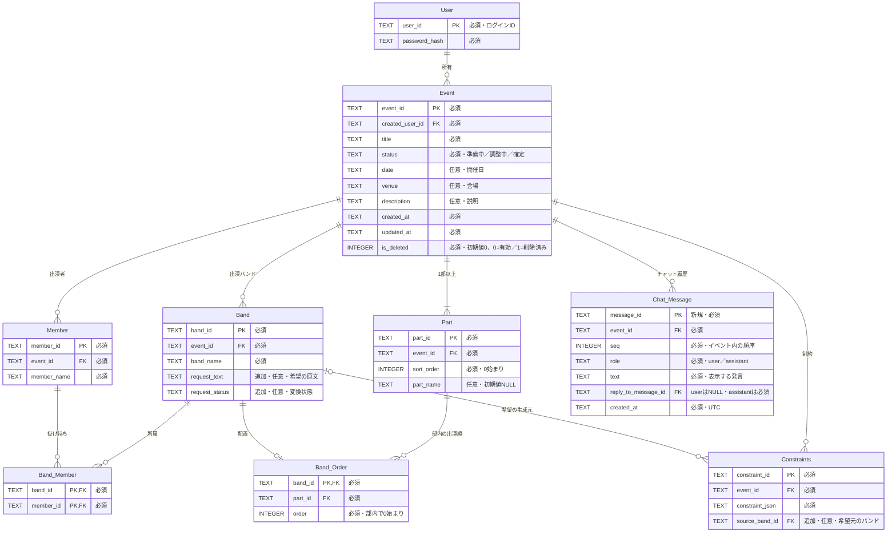

# DB方針・設計

Cloudflare D1をDrizzle ORMで扱う。developとmainのDBは分離し、Honoからは`c.env.DB`で接続する。業務API・frontend接続・認証は後続Issueで実装する。今回の確認はローカルD1のみ。

## 正本と配置

DBのテーブル定義は`apps/backend/src/db/schema.ts`で管理する。この資料は[Issue #45](https://github.com/jphacks/tka_2604/issues/45)の希望・由来・チャット履歴・部名の追加と、[Issue #14](https://github.com/jphacks/tka_2604/issues/14)と2026-10-16の合意を実装用に反映する。

| 場所                                | 役割                                                           |
| ----------------------------------- | -------------------------------------------------------------- |
| `apps/backend/src/db/schema.ts`     | Drizzleのテーブル・キー・一意制約・CHECK。変更するDB定義の入口 |
| `apps/backend/src/db/index.ts`      | D1 bindingからDrizzleを作成                                    |
| `apps/backend/src/db/events.ts`     | 所有者・論理削除で絞った読み込み、イベント作成・論理削除       |
| `apps/backend/src/db/save-event.ts` | イベント単位の一括保存と更新競合の拒否                         |
| `apps/backend/drizzle.config.ts`    | SQLite方言、schemaとmigrationのパス。接続情報は持たない        |
| `apps/backend/db/migrations/`       | Drizzle生成SQL、差分用のmeta、カスタムSQL。すべてGit管理       |
| `apps/backend/db/seed.sql`          | ローカル確認用ダミーデータ                                     |
| `apps/schema/`                      | 制約JSONの正本。DBテーブル定義とは別                           |

## テーブルと型

`PK`は主キー、`FK`は外部キー。必須はNOT NULL、任意はNULLを許す。ID・文字列・JSON・日時はTEXT、順番と論理削除はINTEGER。TypeScriptでは`isDeleted`をbooleanとして扱い、DBには0／1で保存する。

状態の保存値は既存frontendに合わせ`planning`／`adjusting`／`confirmed`、初期値は`planning`。日時はUTCのISO 8601文字列。開催日は任意の`YYYY-MM-DD`。パスワードはハッシュのみを保存し、取得結果・ログに含めない。ハッシュ方式・セッションは#13で決める。Userはメールアドレスを持たず、Eventの所有者は一人。共同管理テーブルは作らない。

## DBが保証すること

- `Band_Member`は`(band_id, member_id)`が主キー。名前が同じでもMemberのIDが違えば別人で、掛け持ちは同じMemberを複数Bandへ紐づける。
- `Band_Order`は`band_id`が主キー。`(part_id, order)`を一意にし、1バンドの複数配置・同じ位置への重複配置を拒否する。
- `Part(event_id, sort_order)`は一意。部内順・部の表示順は0以上の整数。
- 所属のBandとMember、配置のBandとPartは同じイベントに限定する。追加・更新時のカスタムSQLトリガーで検証し、Band・Member・Partのイベント移動も拒否する。
- 外部キーで存在しない所属・配置先を拒否する。Band削除時の所属・配置、Member削除時の所属はCASCADEで削除する定義だが、今回の一括保存処理ではBand・Memberレコードの削除を受け付けない。制約JSONの参照先にはFKを張らない。
- 制約は1件1行。独立したtype列は作らない。JSONの構文と、JSON内のconstraint_id・event_idが列と一致することをCHECKする。
- 最後の1部と、制約の`params.part_ids`で参照されている部の削除はトリガーで拒否する。バンドが配置された部の削除はFKで拒否する。有効／無効を問わず、残っている参照制約を対象にする。

全JSON Schemaの検証や、対象ID・位置の有効性、制約の達成判定をDBのCHECKだけで保証したとは扱わない。制約の形式の正本は引き続き`apps/schema`。HTTP入力の実行時検証・表示・計算は業務API実装時にも必要。

## 部と制約の動作

- イベント作成処理はEventと最初の空のPartを同じD1 batchで保存する。EventへのSQL INSERT単独では部の自動作成は行わない。
- Partは空でも存在できる。枠数・空き枠は保存しない。各部のバンド数は配置の件数から求める。
- バンド登録直後は未配置。Band_Orderに行がなければ未配置とする。
- 部名は任意のpart_name（初期値NULL）に保存する。未入力・空欄ならsort_orderに対応する「第n部」を表示する仕様とし、frontendの対応は#32で行う。#45はbackendの定義・取得・保存のみを変更する。保存済み部名は並べ替えで変更しない。
- 部を並べ替えても制約JSONの番号は変更しない。制約に違反する移動・固定解除前の移動を操作段階で拒否せず、違反を表示する方針。バンドは削除ではなく未配置へ戻し、メンバーも名簿に残す。DB上の重複や別イベント参照とは区別する。
- 配置済みの部は先にバンドを未配置または別の部へ移動する。制約参照中の部は先に制約を変更・削除する。最後の1部は削除不可。
- 部を削除した後の表示順を詰めても、制約JSONはそのまま保持する。

## 保存・論理削除

保存は操作ごとの自動保存ではなく、画面の「保存」でまとめて行う方針。部の追加・削除・並べ替えも`saveEvent`に含め、部だけを即時保存する処理は用意しない。画面上で先に未配置化・移動して空にした部の削除は、同じ一括保存に含められる。D1は通常のSQL BEGINによる対話型トランザクションではなく、複数文を`batch()`にまとめる。途中の文が失敗したら全体がロールバックされることを結合テストで確認する。

Eventはis_deletedを1にする論理削除。配下は残し、通常の読み込みは所有者が一致してis_deleted=0のEventだけ返す。復元画面・保持期限・物理削除は対象外。`saveEvent`はイベントの編集可能な全データを受け取り、一括保存する。Band・Memberは残して所属・配置を置き換えるため、所属のないメンバーも名簿に残る。固定位置などの制約に違反する配置や未配置も保存できる。制約の形・達成状況の検証とエラー表示は業務API・画面側の責務。

読み込み時のupdatedAtを保存時に渡す。保存の最初の文で所有者・is_deleted・updatedAtを再確認し、異なればbatch全体をロールバックする。同時保存は片方だけ成功する。時刻は前回より必ず1ミリ秒以上進め、同一ミリ秒内の保存も区別する。作成日時・所有者・削除フラグは一括保存の入力から変更できない。

保存処理は信頼できるuser_idを受け取る内部関数で、ユーザーの認証自体は行わない。業務APIから呼ぶ際に認証済みユーザーを渡す。

#15のイベント本体APIは`Route → Service → Repository`で接続する。`apps/backend/src/repositories/events.ts`は所有者・論理削除で絞った基本情報と独立した件数集計を返し、設定更新は`updatedAt`を条件にして原子的に行う。作成・論理削除は既存の`db/events.ts`を利用する。認証の追加前はRoute内の仮ID定数`demo-owner`を渡し、#57で認証済みIDへ置き換える。APIの詳細は[イベントAPI](../apps/backend/docs/api/events.md)を参照。

## 後続Issueで扱うこと

画面側の「保存」ボタンの接続・制約違反の表示・Solverへの接続、入力の実行時検証は業務API・画面のIssueで扱う。未保存内容のリアルタイム同期は不要。イベントの復元UIと、Band・Memberの削除機能は今回の対象外。

適用・生成・ダミーデータ・テストと作り直しは[DB手順](../apps/backend/db/README.md)を参照する。

## 希望・由来・チャットの保存（#45）

[AIチャット設計](../apps/backend/docs/AIチャット設計.md)を参照する。希望はBand.request_text、状態はrequest_status。両方NULLなら希望なし、原文がある場合はpending／needs_confirmation／converted／failedを指定する。convertedは制約へ変換済みを意味し、計算の成功を意味しない。

Constraints.source_band_idは任意の希望元。FKと挿入・更新トリガーで同イベントのBandだけを許す。既存saveEventは、同じconstraint_idの由来とBandの希望を保持し、クライアント入力の余分な項目で上書きしない。

chat_messagesはmessage_idをPK、(event_id, seq)・reply_to_message_idをそれぞれ一意にする。seqは0以上の整数。userは返信先NULL、assistantは同イベントの先行userへの返信を必須とする。event_id・seq・role・返信先は保存後に変更しない。メッセージ保存・取得のHTTP APIや自動採番は#47で追加する。発言の保存だけでEvent.updatedAtを更新しない。

0002_wishes_chat_and_part_nameはDrizzle生成SQLで、commentをpart_nameへリネームし、列・履歴テーブルを追加する。0003_chat_integrityは希望状態・由来・返信の整合性を保証するカスタムトリガー。親テーブルの作り直しを避け、既存の所属・配置・名前・NULLを維持する。適用済みの0000・0001は変更していない。

イベント本体の業務APIは#15で追加。表・制約・チャット履歴は後続の別APIで取得する。後続APIではpartName・希望状態・由来を用途に応じてDTOへ写し、パスワードハッシュやDB管理項目を不用意に公開しない。
